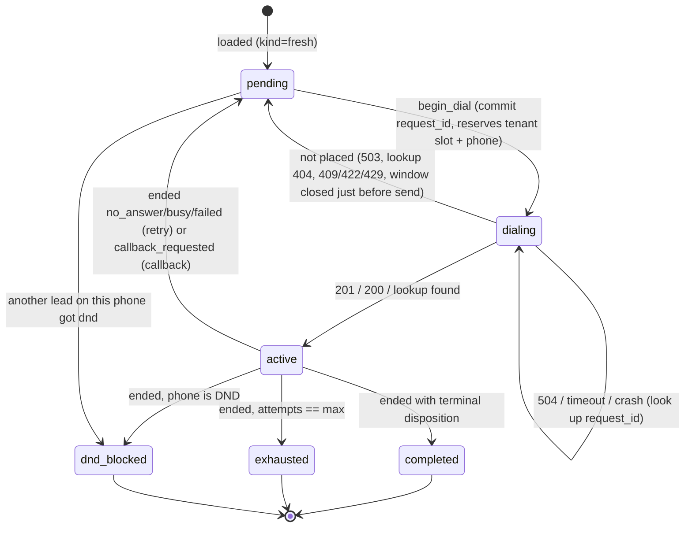

# Submission

## Candidate
- **Name:** Dhruthik0
- **Assignment chosen:** B (Workflow): Durable Campaign Dispatcher
- **Time spent (honest estimate):** _fill in_

## How to run
```bash
# setup (Python 3.11+)
python -m venv .venv && source .venv/bin/activate
pip install -r requirements.txt

# terminal 1: mock provider
cd assignment-b-workflow && python -m mock_telephony

# terminal 2: dispatcher (exits after writing final_state.csv when every lead is final)
cd solution && python -m dispatcher
#   options: --provider URL (default http://127.0.0.1:8099)  --port N (default 8200)
#            --db PATH --out PATH (defaults solution/dispatcher.db and solution/final_state.csv,
#            resolved from the code's location, so they don't depend on the cwd)
#   progress: curl -s localhost:8200/status

# tests (from repo root, no mock needed)
pytest

# full run with N random kill -9s, then diff final_state.csv against /admin/leads
solution/chaos.sh 3 1 7        # KILLS FAILURE_SCALE SEED  (starts its own mock; stop any other on :8099)
#   env knobs: SPEED=600 KILL_MIN=5 KILL_MAX=40 DOWNTIME=1 (real seconds)
solution/crash_inject.sh 0.03 8 # crash at exact commit/HTTP boundaries with prob 0.03 per step
python solution/mutants.py      # break each rule in a temp copy; checks the tests catch it
```
A restart is just running `python -m dispatcher` again. It resumes from the same DB. Running it
again after it finished rewrites the same `final_state.csv` and exits without placing calls. A
second copy started while one is running on the same DB exits at once with status 2 (file lock). If the
provider was restarted (new world, detected by its `real_epoch`), the dispatcher starts from
scratch. If the scheduling loop ever raises, the process exits with status 1 so a supervisor can
restart it, instead of leaving a webhook server running with nothing dispatching.

## Design

**One asyncio process, SQLite as the source of truth.** A FastAPI app receives webhooks; a
background task runs the scheduling loop every 20 ms of real time (12 simulated seconds at 600x).
All business rules use the provider's simulated clock, computed locally from `/v1/clock`
(`sim_epoch + (time.time() - real_epoch) * speed`).

I chose a DB-backed state machine over Temporal: 200 leads, one process, and the hard part
(at-most-once dialling across an ambiguous API) is solved by the idempotency key either way.
SQLite in WAL mode means every committed transaction survives `kill -9` (`synchronous=NORMAL`;
`FULL` would only add power-loss safety at the cost of an fsync per commit).

Code is split in three:
- `rules.py`: pure functions (window maths, next attempt time, priority, `pick`). No I/O, no
  clock. This is what the unit tests hammer.
- `store.py`: the lead state machine in SQLite.
- `service.py`: talks to the provider, receives webhooks, reconciles unknowns.

**Lead state is derived, not assigned.** The `calls` table stores only facts the provider told us
(call accepted; call ended with status/disposition). The only direct writes are `begin_dial`
(pending → dialing, sets `request_id`) and `abort_dial` (clears it). After any fact is recorded or a dial is aborted, `_refresh`
recomputes the lead's state from its calls, the global DND set, and its in-flight `request_id`:

```
dialing     if it has a request_id the provider hasn't confirmed yet
active      elif any of its calls hasn't ended
completed   elif any call had a terminal disposition        ┐
exhausted   elif accepted calls >= max_attempts             ├ R9 precedence
dnd_blocked elif its phone is in dnd_phones                 ┘
pending     else (kind = callback | retry | fresh, ready_at from the last ended call)
```
Facts only get added, so recording the same fact twice (duplicate webhook, webhook + poll,
replay after a crash) is a no-op by construction. There is no "if already processed" bookkeeping
to get wrong.

### Lead lifecycle

A webhook can arrive while the lead is still `dialing` (before we read the 201), and a lookup can
return a call that has already ended. In both cases the call row is created from that result and
the lead goes straight from `dialing` to its post-call state (pending or a final state).

### At-most-once dialling
1. **Commit before calling.** `begin_dial` writes `state=dialing, request_id=...` in a transaction
   *before* the HTTP request. A `dialing` lead counts toward its tenant's concurrency and locks its
   phone, exactly like an active call.
2. **Deterministic idempotency key:** `request_id = "{campaign}:{lead}:{attempt_no}"`, where
   `attempt_no` = accepted calls we know about + 1. Re-sending an attempt (after a 503, 504,
   timeout or crash) always reuses the same key, so the provider can only ever create one call
   for it. If we lost track of an accepted call, the next attempt computes the same key and the
   provider replays the existing call (200) instead of placing a new one.
3. **Unknown outcomes are resolved, not guessed.** 504, connection errors, timeouts, and any lead
   found in `dialing` after a restart go through `GET /v1/calls?request_id=`: found → record the
   call; 404 → not placed, back to `pending`. Until resolved, the slot stays reserved.
4. **Lost webhooks:** any call still active 8 simulated minutes after creation (the mock's
   longest call is ~6.5) is polled with `GET /v1/calls/{sid}` every 2 simulated minutes.

### Scheduling (`rules.pick`)
Each tick: take all `pending` leads, sort by (callback < retry < fresh, due time, ids), and admit
greedily while the lead is due, its campaign window is open, its phone is neither busy nor DND,
and its tenant has a free slot. The window is the campaign window intersected with 09:00–21:00
IST. We never start a call in the window's last `max(20 s, 50 ms × speed)` of simulated time
(30 s at the default 600x, 10 min at 12000x), because every real millisecond between deciding and
the provider receiving the request is `speed` simulated milliseconds. The dial task also checks
the window again with a fresh clock reading right before sending.

## Decisions & assumptions

| Decision | Why | Alternative considered |
|---|---|---|
| SQLite state machine, single process | Small scale; committed transactions are the durability boundary; easy to reason about under `kill -9` | Temporal: more moving parts for the same guarantee here |
| `request_id = campaign:lead:attempt_no` | Deterministic, so a retry can't double-dial even if our DB were lost or a lookup raced the provider and returned 404 | Random UUID committed before the call: also safe under `kill -9`, but a new UUID after any state loss could place a second call |
| Lead state recomputed from facts | Idempotent by construction; R9 precedence lives in one `if` chain | Event-driven transitions with "already processed" flags |
| `dialing` counts toward concurrency and phone lock | Prevents R2/R3 violations when the provider accepted a call we haven't heard back about | Counting only confirmed calls (unsafe after 504) |
| 503 → back to pending, re-decided next tick | The rules (window, priority) are re-checked with fresh time before re-sending | Retry immediately in a loop (could cross window close) |
| End-of-window margin `max(20 s, 50 ms real × speed)` + re-check right before sending | Decision and arrival at the provider differ by real latency × speed. A fixed 20 s margin produced 3 `outside_calling_window` violations at 12000x (cold-start HTTP latency ~55 ms) | Fixed 60 s: pushes a callback due at 18:59 to the next day at 600x, yet still too small at 12000x |
| Poll active calls after 8 sim min | Mock calls last ≤ 6.5 sim min; holding the slot a bit longer is safe, never short | Poll everything every tick (load) |
| 409/422/429 → log ERROR, lead back to pending but held for 5 sim min | They mean our model is wrong. Each one is a violation, so we must not re-send every tick | Re-send next tick (one mistake becomes dozens of violations); crash the process |
| New provider world (`real_epoch` changed) → reset DB | Old state refers to calls that no longer exist | Refuse to start |
| Webhook with bad signature → 401; bad JSON / missing fields / unknown lead → 400; body never logged | Never trust an unsigned body; the body contains a phone number (PII) | Silently 200 |
| Fresh leads ordered by campaign, then lead id | Deterministic; spec doesn't define fairness between campaigns | Round-robin across campaigns |
| One dispatcher per DB, enforced with `flock` on `<db>.lock` | Two copies would each fill the same free tenant slots: a test run with an accidental second copy got 1 `tenant_concurrency_exceeded`. The kernel releases the lock when the process dies, so `kill -9` never leaves a stale lock | PID file (goes stale after `kill -9`) |
| Exit after writing `final_state.csv` | Spec says "runs until every lead reaches a final state" | Keep serving |

## Failure modes considered
- **`kill -9` anywhere:** every transition is a committed transaction before the side effect.
  Between `begin_dial` and the 201 → lead is `dialing`, resolved by lookup on restart. Between
  receiving a webhook and replying 2xx → provider redelivers; recording is idempotent.
- **503:** not placed; slot released; same `request_id` reused later.
- **504 / timeout / connection error on POST:** look up by `request_id`; slot held until known.
- **Duplicate webhooks:** no-op (facts already recorded).
- **Webhook before the 201:** call row created from the webhook; the late 201 is a no-op.
- **Lost webhooks:** polling recovers them.
- **Webhooks while the dispatcher is down:** provider retries (~7 real s); after that, polling.
- **Forged webhooks:** HMAC-SHA256 verified with `hmac.compare_digest`.
- **DND recorded at the provider but not yet known to us:** the lead that got `dnd` is still
  `active` in our DB until its webhook (or poll) arrives, so it still holds the phone lock and no
  other lead on that phone can be dialled in between.
- **Started twice by mistake:** the second copy can't take the DB lock and exits with status 2
  before contacting the provider.
- **SIGTERM / Ctrl-C:** same as `kill -9`; nothing relies on a clean shutdown.
- **Scheduling loop crashes (DB error, bad config):** logged and the process exits with status 1;
  a restart resumes from the DB.
- **Provider rejects a dial (409/422/429):** should never happen; logged at ERROR and that lead is
  held back 5 sim minutes so the mistake can't repeat every tick.

**Not handled / known limits:**
- A lookup can race a POST the provider hasn't processed yet: we crash while a POST is in flight
  and restart within milliseconds, or our 10 s client timeout fires while the provider is still
  working on the request. The lookup sees 404, the slot and phone lock are released, and the
  provider may then place the call. The deterministic `request_id` still prevents a second call to
  that lead, but another lead could take the slot (a 429 or 409). The mock answers within 2 s, so
  this can't happen against it. Fix: wait one request timeout before trusting a 404.
- Single process only. The lock stops a second copy on the same DB, but not two dispatchers with
  different DBs talking to one provider. Real horizontal scale needs a DB-level slot reservation
  (Postgres `SELECT ... FOR UPDATE SKIP LOCKED` or a per-tenant counter row). `fcntl.flock` also
  means Linux/macOS only.
- The local clock assumes the dispatcher and provider share a machine clock (true here).
- A provider restart *while the dispatcher keeps running* isn't detected (only at startup).
- The 5-minute hold after a rejection is in memory, so it's lost on restart.
- A campaign whose window can never open (e.g. 06:00–08:30, entirely outside 09:00–21:00) is
  logged as a warning at startup; its leads stay pending, so the run never finishes. The spec
  doesn't say what final state such leads should get.
- At extreme speeds, a real latency spike could still land a call after the window closes. At
  1200x that needs more than 150 ms between the pre-send check and the provider (50 ms of margin
  plus the provider's 120 s of grace, which is 100 ms of real time).
- If our model ever disagreed with the provider's, a rejected lead would be re-sent every 5 sim
  minutes (each one a violation) and the run would not finish. There is no circuit breaker.
- A due callback can wait behind calls already in progress if the tenant is at capacity; we don't
  reserve slots ahead of known callbacks.

## Testing
- `pytest` (697 test cases, ~6 s, no network, fake clock; also passes on Python 3.11 in Docker):
  - `test_rules.py`: window boundaries (inclusive start, exclusive end, margin), regulatory
    intersection, days of week, UTC input, next opening across a weekend, retry delays per status,
    callback outside window → next opening, priority ordering, tenant limit shared across
    campaigns, one call per phone, DND, closed window only blocks its campaign.
  - `test_store.py`: deterministic `request_id` reuse after 503, duplicate webhook, webhook before
    201, callback kind, exhaustion, DND across campaigns, exhausted beats dnd_blocked, DND while
    another lead is mid-call (defensive: R3 makes it unreachable), state survives reopen, new world
    resets, and the `final_state.csv` contract (exact header, sort order, last status/disposition
    from the most recently ended call, empty when none).
  - `test_service.py`, against a scripted fake provider (`httpx.MockTransport`): 201, 503 (slot
    released, same `request_id`), 504 resolved by lookup (placed and not placed), POST timeout,
    409 back-off, window re-check before sending, webhook signature (401), duplicate webhook,
    malformed webhook incl. signed non-object JSON (400).
  - `test_properties.py` (randomised, fixed seeds):
    - `next_open`/`is_open` match a brute-force scan on 300 random windows.
    - `pick` never breaks R2/R3/R8, only picks due leads in open windows, and never skips a
      higher-priority lead it could have dialled (300 random scenarios).
    - The store ends in the same state when 60 random call histories are replayed shuffled and
      with duplicates.
    - A one-off deep run of the same properties with 4,700 / 4,700 / 740 seeds also passed.
    - This found a real bug: a campaign window lying entirely outside the regulatory window was
      reported as opening at 09:00. Fixed: `next_open` returns `None` and the dispatcher warns.
- `python solution/mutants.py`: mutation testing. It breaks one rule at a time in a temp copy (32
  mutants: ignore the regulatory window, count a tenant limit off by one, swap R9 precedence, treat
  504 as not placed, skip the signature check, ...) and checks that `pytest` fails. 31 are caught.
  The survivor ("a duplicate webhook overwrites the stored result") can't change anything, because
  the provider's duplicate deliveries are identical. A first pass caught only 29; the 2 real gaps
  (CSV sort order, last status from the most recent call) now have a test.
- `solution/chaos.sh`: end-to-end against the real mock with random `kill -9`s, diffing
  `final_state.csv` against `/admin/leads`.
- Not tested in pytest: the scheduling loop itself and lost-webhook polling (covered by
  `chaos.sh`, whose logs show polls recovering lost webhooks).

## Results
All runs below used the final code. Each started a fresh mock, ran the dispatcher to completion,
then checked `/admin/report` and diffed `final_state.csv` against `/admin/leads`. The default
case is `solution/chaos.sh 3 1 2026`. Most others used the same script with its `SPEED`,
`KILL_MIN`/`KILL_MAX` and `DOWNTIME` knobs, e.g. `SPEED=1200 KILL_MIN=3 KILL_MAX=15 solution/chaos.sh 6 1 314`.
The crash-injection rows used `solution/crash_inject.sh`. The start-before-mock row was a manual
run, since `chaos.sh` waits for the mock.

| Scenario | Speed | Seed | Failure scale | Crashes | Violations | Mismatches (of 200) | Callback lateness p50 / p90 / max (sim min) |
|---|---|---|---|---|---|---|---|
| Default | 600x | 2026 | 1 | 3 × `kill -9` | **0** | **0** | 0.2 / 4.2 / 20.9 |
| Rapid kills (every 2–6 s) | 600x | 4242 | 1 | 15 × `kill -9` | **0** | **0** | 0.2 / 2.7 / 10.1 |
| Double failures | 600x | 777 | 2 | 3 × `kill -9` | **0** | **0** | 0.3 / 8.6 / 40.6 |
| Long outage (12 s real each) | 600x | 808 | 1 | 3 × `kill -9` | **0** | **0** | 0.3 / 879.4 / 934.2 |
| Slow clock | 300x | 55 | 1 | 3 × `kill -9` | **0** | **0** | 0.1 / 3.2 / 8.0 |
| Fast clock | 1200x | 314 | 1 | 6 × `kill -9` | **0** | **0** | 0.5 / 14.6 / 3823.4 |
| Very fast clock | 12000x | 11 | 1.5 | none | **0** | **0** | 8.8 / 408.0 / 4226.6 |
| Crash injection, p = 0.03 per step | 600x | 8 | 1 | 61 | **0** | **0** | n/a |
| Crash injection, p = 0.08 per step | 600x | 9 | 1.5 | 199 | **0** | **0** | n/a |
| Dispatcher started 3 s before the mock | 600x | 606 | 1 | none | **0** | **0** | n/a |
| Clean run, then run again on the finished DB | 600x | 99 | 0 | none | **0** | **0** | 0.2 / 2.0 / 4.9 |
| Unseen seeds | 600x | 1, 42, 1000, 31337, 4711 | 1 | 3–4 × `kill -9` each | **0** each | **0** each | max 7.6–21.5 |
| Triple failures | 600x | 2027 | 3 | 5 × `kill -9` | **0** | **0** | 0.2 / 19.5 / 20.5 |
| SIGTERM instead of kill -9 | 600x | 123 | 1 | 3 × SIGTERM | **0** | **0** | 0.2 / 2.4 / 3.6 |
| Ctrl-C (SIGINT) | 600x | 321 | 1 | 3 × SIGINT | **0** | **0** | 0.2 / 4.3 / 24.7 |
| Process frozen 6 s (SIGSTOP/SIGCONT) | 600x | 555 | 1 | 3 freezes | **0** | **0** | 0.2 / 4.8 / 53.0 |
| Second copy started mid-run, same DB | 600x | 888 | 1 | 3 attempts | **0** | **0** | 0.1 / 1.3 / 20.4 |

- The rows from "Clean run" down were run with a separate test script (start the mock, inject the
  event at random 5–35 s intervals, restart, compare), not `chaos.sh`. Running the dispatcher again
  on the finished DB took 0.6 s, placed no calls (`calls_total` unchanged) and wrote a
  byte-identical CSV.
- Before the lock existed, the "second copy" run got 1 `tenant_concurrency_exceeded`. With the
  lock, all 3 second copies exited with status 2 and placed nothing.

- Default run, from the dispatcher log: 1 fresh start, 3 resumes, 20 ambiguous 504s resolved by
  lookup, 16 calls whose webhook never came recovered by polling, 0 errors (no 409/422/429). The
  mock counted 19 lost webhooks; a lost webhook is also covered when a lookup after a 504 or a
  restart returns the already-ended call, so not every one needs a poll. Max concurrency seen was 4 for acme and 3 for zen, exactly the limits.
- Crash injection (`solution/crash_inject.py`, driven by `solution/crash_inject.sh`) wraps the
  store and HTTP client and calls `os._exit` at exact points with probability p, then restarts
  until done. The 260 crashes landed:
  - 60 between committing `dialing` and sending the POST
  - 39 after the provider answered 201/503/504 but before we recorded it
  - 39 after a lookup or poll answered but before we recorded it
  - 108 right after committing a call or result (from a 201, lookup, poll or webhook), e.g.
    before replying 2xx to the webhook
  - 14 after `abort_dial`
- Long outage: each restart came 12 s of real time after the kill, longer than the provider's
  ~7 s webhook redelivery window. The provider gave up on some deliveries, and polling recovered
  them.

What the lateness tail means:
- At 600x a restart costs about 1 real second, which is 10 simulated minutes. That explains the
  max of 10–40 minutes in the kill runs.
- In the long-outage run, a 12 s outage is 2 simulated hours. Callbacks that came due during an
  outage near a window's close moved to the next opening, hence the large p90.
- At 1200x and 12000x, one real second is 20 or 200 simulated minutes, and the end-of-window
  safety margin grows with speed (1 and 10 sim min). Callbacks due in that last stretch go to the
  next window opening, which for zen is Monday. That makes the max large; it is never a violation.
- In the crash-injection runs the process restarted 62 and 200 times, so lateness isn't
  meaningful there.

Bugs this testing found, all fixed before the runs above:
- At 12000x, the original fixed 20 s margin produced 3 `outside_calling_window` violations. These
  were cold-start HTTP latency on the first calls of the run. The margin now scales with speed.
- Property tests found that a campaign window entirely outside 09:00–21:00 was reported as opening
  at 09:00.
- Starting a second dispatcher on the same DB caused 1 concurrency violation. Fixed with the lock.
- A correctly signed webhook whose JSON isn't an object (e.g. `[1, 2]`) got a 500 instead of a 400.
- Earlier, from review: a rejected dial was re-sent every tick, and a crash in the scheduling loop
  left the process up but idle.

## If I had another day
1. Wait one request timeout before resolving `dialing` leads after a restart (closes the gap above).
2. Reserve slots for callbacks due in the next few minutes to cut callback lateness.
3. Horizontal scale: move to Postgres and claim leads with `FOR UPDATE SKIP LOCKED` plus a
   per-tenant slot table, so two dispatchers can run with 0 violations.
4. Sleep until the next `ready_at` or window opening instead of scanning every 20 ms overnight.
5. Add a circuit breaker: stop dialling a tenant and alert after repeated 409/422/429.

**Stretch goals picked:** observability (`GET /status` with per-campaign progress) and the note
below. Not attempted: Temporal, horizontal scale (see limits), slot reservation for callbacks.

**At 1M leads/day across 50 tenants** (about 23 new leads a second if spread over the 12-hour
regulatory window, before retries, with peaks at window openings):
- Move SQLite to Postgres; claim leads with `FOR UPDATE SKIP LOCKED` and hold per-tenant slot
  counters in the DB, so several dispatchers can share the work.
- Stop scanning every pending lead each tick. Index `(state, ready_at)` and fetch only leads due
  now in open windows, a page at a time.
- Put webhooks on a queue: the HTTP handler verifies the signature, enqueues, replies 2xx; workers
  apply results. Today's idempotent `record_call` already makes redelivery safe.
- Partition by tenant, so one tenant's backlog or rejections can't starve the others.
- Metrics and alerts: slot utilisation, callback lateness, 504 rate, lost-webhook polls, and any
  provider rejection.
