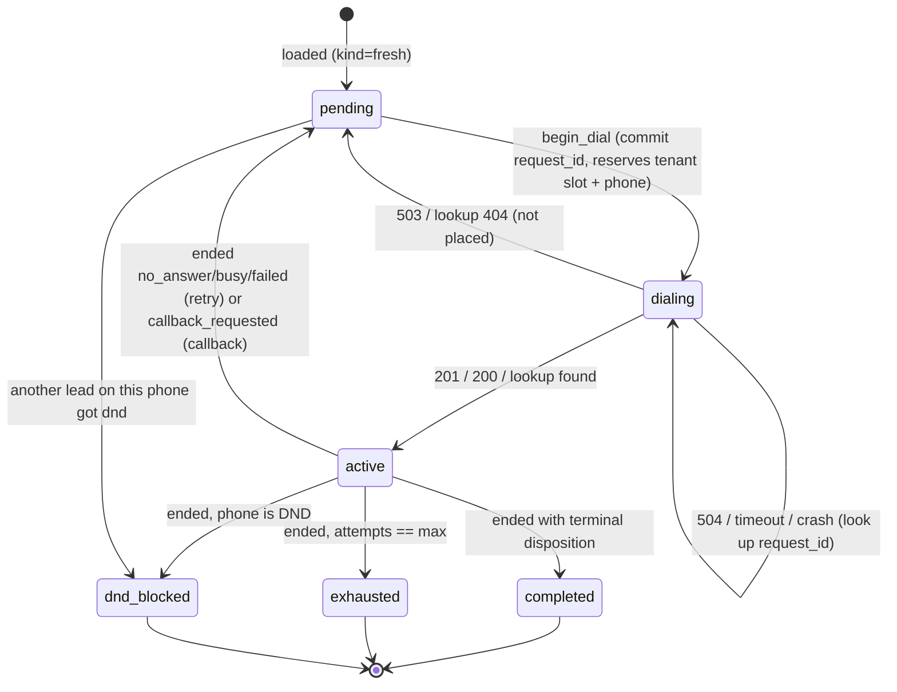

# Submission

## Candidate
- **Name:** Dhruthik0
- **Assignment chosen:** B (Workflow): Durable Campaign Dispatcher
- **Time spent (honest estimate):** _fill in_

## How to run
```bash
# setup (Python 3.11+)
python -m venv .venv && source .venv/bin/activate
pip install -r requirements.txt

# terminal 1: mock provider
cd assignment-b-workflow && python -m mock_telephony

# terminal 2: dispatcher (exits after writing final_state.csv when every lead is final)
cd solution && python -m dispatcher
#   options: --provider http://127.0.0.1:8099 --port 8200 --db dispatcher.db --out final_state.csv
#   progress: curl -s localhost:8200/status

# tests (from repo root, no mock needed)
pytest

# full run with N random kill -9s, then diff final_state.csv against /admin/leads
solution/chaos.sh 3 1 7        # KILLS FAILURE_SCALE SEED  (starts its own mock; stop any other on :8099)
```
A restart is just running `python -m dispatcher` again with the same `--db`. If the provider was
restarted (new world, detected by its `real_epoch`), the dispatcher starts from scratch.

## Design

**One asyncio process, SQLite as the source of truth.** A FastAPI app receives webhooks; a
background task runs the scheduling loop every 20 ms of real time (12 simulated seconds at 600x).
All business rules use the provider's simulated clock, computed locally from `/v1/clock`
(`sim_epoch + (time.time() - real_epoch) * speed`).

I chose a DB-backed state machine over Temporal: 200 leads, one process, and the hard part
(at-most-once dialling across an ambiguous API) is solved by the idempotency key either way.
SQLite in WAL mode with `synchronous=FULL` means every committed transaction survives `kill -9`.

Code is split in three:
- `rules.py`: pure functions (window maths, next attempt time, priority, `pick`). No I/O, no
  clock. This is what the unit tests hammer.
- `store.py`: the lead state machine in SQLite.
- `service.py`: talks to the provider, receives webhooks, reconciles unknowns.

**Lead state is derived, not assigned.** The `calls` table stores only facts the provider told us
(call accepted; call ended with status/disposition). After any fact is recorded, `_refresh`
recomputes the lead's state from its calls, the global DND set, and its in-flight `request_id`:

```
dialing     if it has a request_id the provider hasn't confirmed yet
active      elif any of its calls hasn't ended
completed   elif any call had a terminal disposition        ┐
exhausted   elif accepted calls >= max_attempts             ├ R9 precedence
dnd_blocked elif its phone is in dnd_phones                 ┘
pending     else (kind = callback | retry | fresh, ready_at from the last ended call)
```
Facts only get added, so recording the same fact twice (duplicate webhook, webhook + poll,
replay after a crash) is a no-op by construction. There is no "if already processed" bookkeeping
to get wrong.

### Lead lifecycle

A webhook can arrive while the lead is still `dialing` (before we read the 201); the call row is
created from the webhook and the lead goes straight to its post-call state.

### At-most-once dialling
1. **Commit before calling.** `begin_dial` writes `state=dialing, request_id=...` in a transaction
   *before* the HTTP request. A `dialing` lead counts toward its tenant's concurrency and locks its
   phone, exactly like an active call.
2. **Deterministic idempotency key:** `request_id = "{campaign}:{lead}:{attempt_no}"`, where
   `attempt_no` = accepted calls we know about + 1. Re-sending an attempt (after a 503, 504,
   timeout or crash) always reuses the same key, so the provider can only ever create one call
   for it. If we lost track of an accepted call, the next attempt computes the same key and the
   provider replays the existing call (200) instead of placing a new one.
3. **Unknown outcomes are resolved, not guessed.** 504, connection errors, timeouts, and any lead
   found in `dialing` after a restart go through `GET /v1/calls?request_id=`: found → record the
   call; 404 → not placed, back to `pending`. Until resolved, the slot stays reserved.
4. **Lost webhooks:** any call still active 8 simulated minutes after creation (the mock's
   longest call is ~6.5) is polled with `GET /v1/calls/{sid}` every 2 simulated minutes.

### Scheduling (`rules.pick`)
Each tick: take all `pending` leads, sort by (callback < retry < fresh, due time, ids), and admit
greedily while the lead is due, its campaign window is open, its phone is neither busy nor DND,
and its tenant has a free slot. The window is the campaign window intersected with 09:00–21:00
IST, and we never start a call in the last 20 simulated seconds (network latency at 600x is
several simulated seconds; the provider's 120 s grace covers the rest).

## Decisions & assumptions

| Decision | Why | Alternative considered |
|---|---|---|
| SQLite state machine, single process | Small scale; committed transactions are the durability boundary; easy to reason about under `kill -9` | Temporal: more moving parts for the same guarantee here |
| `request_id = campaign:lead:attempt_no` | Deterministic, so no state needed to retry safely; survives losing the 201 | Random UUID stored before the call: works, but a lost DB write would allow a duplicate |
| Lead state recomputed from facts | Idempotent by construction; R9 precedence lives in one `if` chain | Event-driven transitions with "already processed" flags |
| `dialing` counts toward concurrency and phone lock | Prevents R2/R3 violations when the provider accepted a call we haven't heard back about | Counting only confirmed calls (unsafe after 504) |
| 503 → back to pending, re-decided next tick | The rules (window, priority) are re-checked with fresh time before re-sending | Retry immediately in a loop (could cross window close) |
| 20 s end-of-window margin | Our decision time and the provider's arrival time differ by network latency × 600 | 60 s: safer, but pushes a callback due at e.g. 18:59 to the next day |
| Poll active calls after 8 sim min | Mock calls last ≤ 6.5 sim min; holding the slot a bit longer is safe, never short | Poll everything every tick (load) |
| Unknown 4xx (409/422/429) → log ERROR, back to pending | They mean our model is wrong; we want it loud, and the rules will be re-checked | Crash the process |
| New provider world (`real_epoch` changed) → reset DB | Old state refers to calls that no longer exist | Refuse to start |
| Webhook with bad signature → 401; unknown lead → 422 | Never trust an unsigned body | Silently 200 |
| Fresh leads ordered by campaign, then lead id | Deterministic; spec doesn't define fairness between campaigns | Round-robin across campaigns |
| Exit after writing `final_state.csv` | Spec says "runs until every lead reaches a final state" | Keep serving |

## Failure modes considered
- **`kill -9` anywhere:** every transition is a committed transaction before the side effect.
  Between `begin_dial` and the 201 → lead is `dialing`, resolved by lookup on restart. Between
  receiving a webhook and replying 2xx → provider redelivers; recording is idempotent.
- **503:** not placed; slot released; same `request_id` reused later.
- **504 / timeout / connection error on POST:** look up by `request_id`; slot held until known.
- **Duplicate webhooks:** no-op (facts already recorded).
- **Webhook before the 201:** call row created from the webhook; the late 201 is a no-op.
- **Lost webhooks:** polling recovers them.
- **Webhooks while the dispatcher is down:** provider retries (~7 real s); after that, polling.
- **Forged webhooks:** HMAC-SHA256 verified with `hmac.compare_digest`.
- **DND while another lead on that phone is mid-call:** that lead stays `active`; when its call
  ends it is re-derived (completed > exhausted > dnd_blocked).

**Not handled / known limits:**
- If we crash *while* a POST is in flight and restart within milliseconds, the startup lookup could
  in theory see 404 before the provider commits the call. The deterministic `request_id` still
  prevents a double dial, but the slot might be released briefly. Fix: wait one request timeout
  before resolving `dialing` leads found at startup.
- Single process only. Two dispatchers could both `pick` the same free slot (the
  `begin_dial ... WHERE state='pending'` guard prevents double-dialling the same lead, but not two
  different leads overfilling a tenant). Needs a DB-level slot reservation (Postgres
  `SELECT ... FOR UPDATE SKIP LOCKED` or a per-tenant counter row).
- The local clock assumes the dispatcher and provider share a machine clock (true here).
- A due callback can wait behind calls already in progress if the tenant is at capacity; we don't
  reserve slots ahead of known callbacks.

## Testing
- `pytest` (26 tests, < 1 s, no network, fake clock):
  - `test_rules.py`: window boundaries (inclusive start, exclusive end, margin), regulatory
    intersection, days of week, UTC input, next opening across a weekend, retry delays per status,
    callback outside window → next opening, priority ordering, tenant limit shared across
    campaigns, one call per phone, DND, closed window only blocks its campaign.
  - `test_store.py`: deterministic `request_id` reuse after 503, duplicate webhook, webhook before
    201, callback kind, exhaustion, DND across campaigns, exhausted beats dnd_blocked, DND while
    another lead is mid-call, state survives reopen, new world resets.
- `solution/chaos.sh`: end-to-end against the real mock with random `kill -9`s, diffing
  `final_state.csv` against `/admin/leads`.
- Not tested in pytest: the HTTP layer of `service.py` (covered by `chaos.sh` instead).

## Results
Final run with `solution/chaos.sh 3 1 2026`: default failure injection, seed 2026 (not the
default 7), dispatcher `kill -9`'d 3 times at random points and restarted. Takes ~2.5 real minutes.

```json
{
 "calls_total": 422,
 "calls_active": 0,
 "calls_by_status": {"no_answer": 116, "completed": 219, "busy": 58, "failed": 29},
 "violation_count": 0,
 "violations_by_type": {},
 "max_concurrency_seen": {"acme_insurance": 4, "zen_retail": 3},
 "callback_lateness_minutes": {"count": 71, "p50": 0.7, "p90": 5.6, "max": 9.1},
 "webhooks": {"delivered": 461, "lost": 10, "duplicates": 49}
}
```
- `final_state.csv` vs `/admin/leads`: **200 leads, 0 mismatches**.
- Dispatcher log: 1 fresh start + 3 resumes, 20 ambiguous 504s resolved by lookup, 10 lost
  webhooks recovered by polling, 0 errors (no 409/422/429 from the provider).

Other runs:

| Seed | Failure scale | kill -9 | Violations | Mismatches |
|---|---|---|---|---|
| 7 | 0 | 0 | 0 | 0 |
| 7 | 1 | 3 | 0 | 0 |
| 11 | 1.5 | 6 | 0 | 0 |
| 23 | 1.5 | 5 | 0 | 0 |
| 99 | 1.5 | 6 | 0 | 0 |

Seeds 11, 23 and 99 ran before the end-of-window margin was cut from 60 s to 20 s; the
seed 2026 run above uses the final code.

Observations:
- Concurrency stays at the limit (4 and 3), so throughput is bounded by the tenant caps, not by
  the dispatcher.
- Callback lateness is mostly under a minute. The tail (p90 5.6, max 9.1 sim min) comes from
  restarts (each restart takes about 1 real second, which is 10 sim minutes) and from callbacks
  that come due while every tenant slot is busy.

## If I had another day
1. Wait one request timeout before resolving `dialing` leads after a restart (closes the gap above).
2. Reserve slots for callbacks due in the next few minutes to cut callback lateness.
3. Horizontal scale: move to Postgres and claim leads with `FOR UPDATE SKIP LOCKED` plus a
   per-tenant slot table, so two dispatchers can run with 0 violations.
4. Test `service.py` against an in-process fake provider (scripted 503/504/lost webhooks).
5. At 1M leads/day across 50 tenants: partition work by tenant, index `pending` by `ready_at`
   instead of scanning, push webhooks through a queue, and add metrics on slot utilisation and
   callback lateness.
